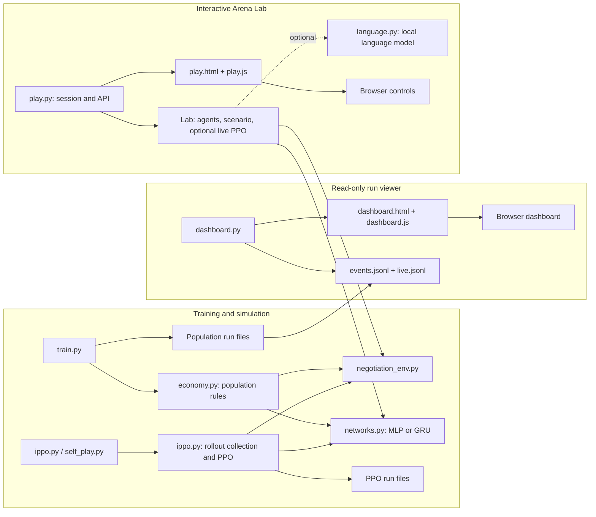
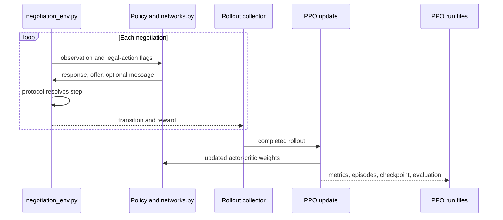
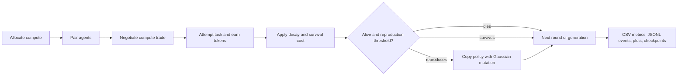

<div align="center">

# Learning to Bargain

**Agents that learn to negotiate: with PPO, with a side channel to talk over, and with their lives on the line**


[Report](REPORT.md) · [Live demo](DEMO.md) · [Quick start](#quick-start) · [Results](#results-in-detail)

</div>

---

Two agents have to divide 100 tokens. They can take turns making offers, or bid in secret. They can be given
a channel to talk over that cannot affect payoffs. They can be dropped into a population where the deals they
strike decide whether they eat, die or have children.

This repository builds that world, trains agents in it with PPO, and measures what they learn. The findings
are written up in [REPORT.md](REPORT.md); the archived numbers behind them are in `results/`.

## Highlights

| Question | What the agents did |
|---|---|
| Do they find the game-theoretic answer? | Yes. They rediscover the **Rubinstein split**, 52/48 against a predicted 51.3/48.7, without being told the game has a solution. |
| Does talking help? | No. A **cheap-talk channel stays empty**: η² between messages and later offers is below 0.011, and scrambling every message changes nothing. |
| Does memory help? | Not while the game is Markov (p = 0.76, 5 seeds). With a **hidden clock and a biting deadline**, recurrent agents learn **brinkmanship** (p = 0.0002, 8 seeds). |
| What happens in a population? | Agents **self-regulate at about 23 alive**, deals get faster over 500 generations, and generosity drifts down about 4 points. |

Details and caveats are in [Results in detail](#results-in-detail).

## Contents

- [Quick start](#quick-start)
- [The game](#the-game)
- [Architecture](#architecture)
- [Learning and simulation flows](#learning-and-simulation-flows)
- [Install](#install)
- [Run everything, live](#run-everything-live)
- [The Arena Lab](#the-arena-lab)
- [Experiments](#experiments)
- [Results in detail](#results-in-detail)
- [Project map](#project-map)
- [Run artifacts](#run-artifacts)

## Quick start

```bash
python -m venv .venv
source .venv/bin/activate        # Windows: .venv\Scripts\activate
pip install -r requirements.txt
python demo.py                   # population + dashboard + Arena Lab, nothing pre-run
```

Then open the dashboard at http://127.0.0.1:8000/ and the Arena Lab at http://127.0.0.1:8100/. Ctrl+C
stops everything.

> [!TIP]
> Want numbers rather than animation? Run `python ippo.py` (about 5 minutes) to train two independent PPO
> learners and watch them converge on a near-even split.

## The game

Everything runs on one shared negotiation environment, `negotiation_env.py`. A scenario is built from a few
knobs:

| Knob | Options |
|---|---|
| **Protocol** | Take turns making offers, or bid in secret (`--protocol sealed_bid`) |
| **Cheap talk** | A message channel that cannot affect payoffs (`--message-vocab 5`) |
| **Deadline and cost of delay** | How long the pair has, and what waiting costs each side |
| **Observability** | Whether the clock is visible (`--observe-round 0` hides it) |
| **Each side's need** | Set per side in the Arena Lab |
| **Policy** | A feed-forward MLP, or a recurrent GRU (`--policy gru`) |

The environment supplies observations and legal-action flags. The selected protocol resolves offers and
produces the episode outcome and reward. The environment ships with its own tests.

## Architecture

The project has a shared negotiation environment and two ways to improve policies: gradient-based PPO and
evolution in a population. The dashboard observes saved run data; the Arena Lab owns a separate, interactive
set of agents.



`demo.py` starts `train.py`, `dashboard.py`, and (unless disabled) `play.py` as separate processes. The
dashboard can only read the population run's files. The Arena Lab does not read or modify that run.

## Learning and simulation flows

### PPO negotiation

`ippo.py` owns the shared actor-critic, rollout collector, and PPO update used by direct training and
self-play. The MLP uses the current observation; the GRU also carries hidden state across that agent's
decisions. Under self-play, `self_play.py` supplies opponents from a pool of past checkpoints to the same
rollout machinery.



### Population economy

The population path is evolutionary, not PPO training: it negotiates compute trades, earns task rewards,
applies costs, and creates mutated offspring. `train.py` records each generation and saves checkpoints.



The current task is `RandomScoreTask`, a replaceable stub. A `Task` implementation can provide expected
score and an attempt result without changing the economy's negotiation or survival rules.

## Install

```bash
python -m venv .venv
source .venv/bin/activate        # Windows: .venv\Scripts\activate
pip install -r requirements.txt
pytest negotiation_env.py        # 7 tests, ~2 seconds
```

Everything runs on CPU and needs no network after install.

> [!IMPORTANT]
> Use the venv. A global Python with torch built against NumPy 1.x will crash on import.

> [!NOTE]
> The one exception to "no network" is the optional English seat in the Arena Lab. The first time a language
> model is seated, it downloads Qwen2.5-0.5B-Instruct (about 1 GB) to the Hugging Face cache, and runs
> offline from then on.

## Run everything, live

```bash
python demo.py
```

One command, three processes, two browser tabs, nothing pre-run.

| Process | Address | What you see |
|---|---|---|
| **Population** (`train.py`) | none (background) | Starts from random weights and evolves: survival costs, trades, births, deaths |
| **Dashboard** | http://127.0.0.1:8000/ | The population animated as it trains: agents as circles sized by token balance, the negotiating pair centre stage exchanging offers and messages, coins moving on a deal, births and deaths, and the acting agent's network with its activations, accept probability and offer distribution |
| **Arena Lab** | http://127.0.0.1:8100/ | Two agents from random weights that begin learning by self-play the moment it launches, and never stop while it runs |

Within about ten seconds, the Lab's agents learn to turn down a lowball: the chance of accepting 20 of 100
falls from 50% to 0%. Their opening demand overshoots and then settles near an even split. You can play them,
pit them against other negotiators, or press *Start from scratch* to watch it happen again.

| Flag | Effect |
|---|---|
| `--lab-checkpoint runs/<run>/agents.pt` | Start the Lab from trained agents (they keep learning) |
| `--no-lab` | Leave the Arena Lab out |
| `--port` / `--lab-port` | Move the dashboard / the Lab to other ports |

## The Arena Lab

```bash
python play.py --live --from-scratch   # random weights, learning by self-play from the start
python play.py                         # the newest checkpoint under runs/, learning only when you ask
python play.py --checkpoint runs/<run>/agents.pt --live
```

With no checkpoint on disk it starts from random weights either way. Set each side's need, the deadline, the
cost of delay, the protocol and whether the clock is visible, then pick a mode:

| Mode | What it does |
|---|---|
| **Play** | Take a seat yourself and bargain with the trained network. Every one of its moves shows the features it saw, both hidden layers, its accept probability and the Beta it drew its offer from. |
| **Watch** | Seat any two of: a trained agent, a scripted negotiator (rubinstein, conceder, hardball, random) or the language model, and follow the duel move by move. |
| **Learn live** | With `--live`, both agents train against each other (self-play) continuously, and every update hands new weights to the agent across the table, even mid-negotiation. Each move is stamped with the update that made it. Or press *Stop*, pick an opponent such as hardball and train one agent against it. The card charts reward, the chance it takes a lowball, what it opens with and the least it will accept. *Start from scratch* throws the weights away; *Reset to checkpoint* goes back to the file. |
| **Debate in English** | Type a topic ("who gets the bigger office") and seat the language model. It argues in one sentence per turn, then picks its price by scoring a menu of demands (40–90) with its own log-probabilities. The page shows those scores under each sentence. The number, not the sentence, is what the environment receives. |

A language-model turn takes 3–5 seconds on a laptop CPU; the page shows it thinking. `--language-model <hf id>`
swaps in a bigger model and `--language-threads N` sets its cores. The page reports the checkpoint's SHA-256,
and nothing on it is precomputed. The Lab writes no files, and it is separate from `dashboard.py`, which stays
read-only.

## Experiments

| Command | Time | What it does |
|---|---|---|
| `python ippo.py` | ~5 min | Two independent PPO learners, fixed pairing |
| `python self_play.py` | ~5 min | Self-play against a pool of past checkpoints |
| `python train.py --generations 500` | ~3 min | The population economy, unattended |
| `python tournament.py runs/<run>/agents.pt` | ~2 min | A checkpoint against scripted negotiators |
| `python experiments.py --preset policy --seeds 5` | ~15 min | A multi-seed comparison with a permutation test |

Useful flags:

| Flag | Effect |
|---|---|
| `--protocol sealed_bid` | Bid in secret instead of taking turns |
| `--message-vocab 5` | Turn on the cheap-talk channel |
| `--policy gru` | Use the recurrent policy |
| `--observe-round 0` | Hide the clock |
| `--checkpoint <path>` | Evaluate a checkpoint instead of training |

Every script takes `--help`, and every flag is a field on a config dataclass, so the help text is always
current.

## Results in detail

- **Rubinstein split rediscovered.** Agents land on 52/48 against a predicted 51.3/48.7 without being told the
  game has a solution. They beat random and scripted opponents while conceding slightly to the
  theory-optimal agent.
- **Cheap talk stays empty.** Message entropy collapses, η² between messages and later offers is below 0.011,
  and scrambling every message changes nothing. That is the babbling equilibrium theory predicts when
  interests are opposed.
- **Memory pays only when the clock is hidden.** While the game is Markov, memory buys nothing (p = 0.76 across
  5 seeds). When the clock is hidden and the deadline bites, a recurrent population learns **brinkmanship**:
  28% of deals go to the deadline, splits become eight times more unequal, and joint payoffs fall (p = 0.0002
  across 8 seeds).
- **The population economy self-regulates.** Agents settle at about 23 alive against a fixed compute supply,
  and deals get faster over 500 generations. Generosity drifts down about 4 points, a drift too small to call
  selection at this population size.

For methods, plots and discussion, see [REPORT.md](REPORT.md).

## Project map

| File | Role |
|---|---|
| `negotiation_env.py` | The environment: protocols, cheap talk, observability, and its own tests |
| `networks.py` | The two policy trunks, MLP and GRU, behind one interface |
| `ippo.py` | PPO, the rollout collector, evaluation, the shared library the rest imports |
| `self_play.py` | Opponent pool, snapshots, matchmaking, plots |
| `economy.py` | The population: compute, trade, work, upkeep, death, reproduction |
| `train.py` | The unattended entry point: JSONL event log, checkpoints, plots |
| `livelog.py` | The move-by-move stream the dashboard animates |
| `dashboard.py` + `.html` + `.js` | Read-only live dashboard: arena, network panel, charts |
| `demo.py` | Starts the population run, its dashboard and the Arena Lab together |
| `play.py` + `.html` + `.js` | The Arena Lab: play, watch, train on stage, debate in English |
| `language.py` | The optional English seat: a local instruct model whose argument becomes a real offer |
| `baselines.py`, `tournament.py` | Scripted negotiators and a round robin |
| `experiments.py` | Multi-seed runs, aggregation, permutation tests, comparison plots |
| `transcripts.py` | Episode transcripts and the cheap-talk analysis |

## Run artifacts

Each run writes to `runs/<run_id>/`:

| File | Contents |
|---|---|
| `metrics.csv` | One row per update |
| `episodes.csv` | One row per episode |
| `agents.pt` | Weights and config |
| `eval.json` | Evaluation results |
| `plots.png` | Training plots |

The population economy also writes:

| File | Contents |
|---|---|
| `events.jsonl` | One JSON line per generation, including a full sampled negotiation |
| `live.jsonl` | The move-by-move stream from `livelog.py` |
| `checkpoints/` | A checkpoint every 25 generations |

The dashboard only ever reads those files; it cannot write to a run or influence training.
